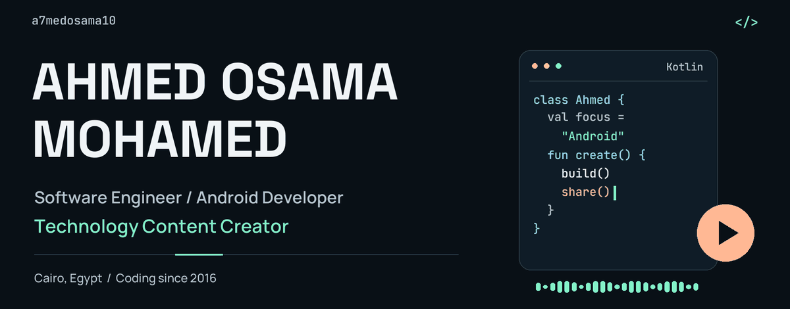
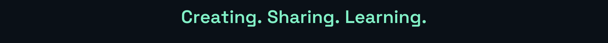
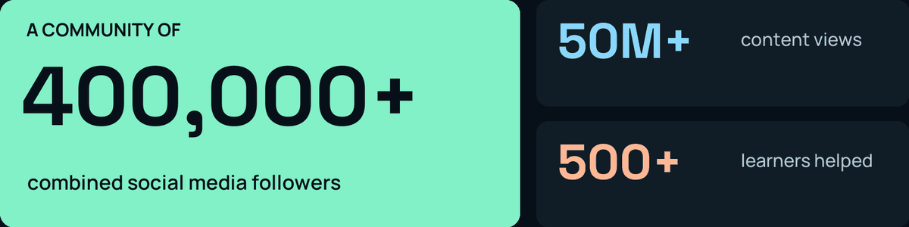
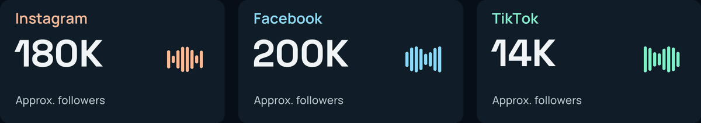
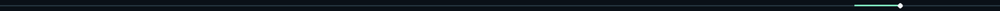
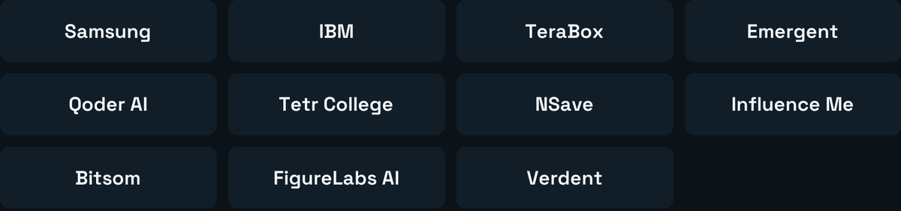
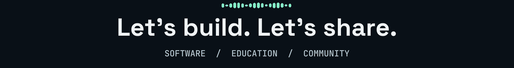

[Uploading README.md…]()

<picture>
  <source media="(prefers-reduced-motion: reduce) and (max-width: 600px)" srcset="./assets/hero-mobile.png" />
  <source media="(prefers-reduced-motion: reduce)" srcset="./assets/hero.png" />
  <source media="(max-width: 600px)" srcset="./assets/hero-mobile.gif" />
  
</picture>

  
  
  

<picture>
  <source media="(prefers-reduced-motion: reduce) and (max-width: 600px)" srcset="./assets/typing-mobile.png" />
  <source media="(prefers-reduced-motion: reduce)" srcset="./assets/typing.png" />
  <source media="(max-width: 600px)" srcset="./assets/typing-mobile.gif" />
  
</picture>

<a href="#community--reach">Community</a> &nbsp; · &nbsp; <a href="#code--create">Skills</a> &nbsp; · &nbsp; <a href="#brand-collaborations">Collaborations</a> &nbsp; · &nbsp; <a href="#the-full-story">My story</a> &nbsp; · &nbsp; <a href="#lets-connect">Contact</a>

## Community & reach

<picture>
  <source media="(prefers-reduced-motion: reduce) and (max-width: 600px)" srcset="./assets/impact-mobile.png" />
  <source media="(prefers-reduced-motion: reduce)" srcset="./assets/impact.png" />
  <source media="(max-width: 600px)" srcset="./assets/impact-mobile.gif" />
  
</picture>

<strong>Technology education for an Arabic-speaking community.</strong>

<picture>
  <source media="(prefers-reduced-motion: reduce) and (max-width: 600px)" srcset="./assets/social-mobile.png" />
  <source media="(prefers-reduced-motion: reduce)" srcset="./assets/social.png" />
  <source media="(max-width: 600px)" srcset="./assets/social-mobile.gif" />
  
</picture>

  
  

<strong>Behind the numbers</strong>

- **400,000+ combined followers**, **50 million+ content views**, and **500+ learners supported** through educational content and initiatives.
- Approximate platform totals: **Instagram 180,000**, **Facebook 200,000**, and **TikTok 14,000**. These are rounded milestones supplied for this profile, not live counters.
- Content covers programming, computer science, artificial intelligence, mobile applications, and educational opportunities.
- **Digital Creator Awards — Education Category Nominee.**
- A multi-platform community built around accessible technology education for Arabic-speaking audiences.

 

<picture>
  <source media="(prefers-reduced-motion: reduce)" srcset="./assets/divider.png" />
  
</picture>

## Code & create

I'm **Ahmed Osama Mohamed**, based in **Cairo, Egypt**. I started learning programming in **2016**, with a focus on **Android, Java, Kotlin, and software engineering**. Since **2022**, I've also been turning technical ideas into educational videos, product demonstrations, and stories that help people learn.

**One path, two ways to contribute:** building useful mobile experiences and making technology easier to understand.

  

| Build | Create |
| --- | --- |
| Java · Kotlin · Android · OOP | Technical storytelling · Educational content |
| Mobile application development · Software engineering | Scripting · Video production · Product demonstrations |
| IntelliJ IDEA · Android development tools · JDK · GitHub | Premiere Pro · CapCut · Canva · Figma |

<strong>Explore my skills & technical interests</strong>

**Software development:** Java, Kotlin, Android development, mobile application development, software engineering, and object-oriented programming.

**Development tools:** IntelliJ IDEA, Android development tools, Java Development Kit (JDK), and GitHub.

**Design and video:** Figma, Canva, CapCut, and Adobe Premiere Pro.

**Content and digital media:** Content strategy and planning, technical scriptwriting, video production and editing, storytelling, product demonstrations, social media management, digital marketing, audience engagement, educational content development, brand collaboration management, and campaign execution.

**Areas I'm exploring:** Artificial intelligence, cloud computing, mobile technologies, software architecture, digital products, information systems, Aviation Information Systems, Aviation Safety Management Systems, technology entrepreneurship, and educational technology.

## Brand collaborations

Technology companies, AI platforms, digital services, and educational organizations I've collaborated with:

<picture>
  <source media="(max-width: 600px)" srcset="./assets/collaborations-mobile.png" />
  
</picture>

<strong>Explore all 11 collaborations & campaign work</strong>

| Brand / organization | Collaboration |
| --- | --- |
| **Samsung** | Galaxy Circle 3.0 Creator Program |
| **IBM** | Technology and educational content |
| **TeraBox** | Sponsored technology content |
| **Emergent** | AI and technology content campaigns |
| **Qoder AI** | AI-powered coding and developer tools campaign |
| **Tetr College of Business** | Educational and higher education promotional campaign |
| **NSave** | Digital services promotion |
| **Influence Me** | Creator campaign |
| **Bitsom** | Sponsored content |
| **FigureLabs AI** | AI-focused promotional content |
| **Verdent** | Technology content collaboration |

**My campaign work includes:**

- Creative concepts, promotional scripts, and short-form videos.
- Demonstrations of technology products, AI tools, and digital services.
- Translating technical features into clear, accessible content.
- Managing deliverables and revisions with brand representatives and marketing teams.
- Creating authentic promotional content tailored to the audience.

## The full story

**Programming since 2016** &nbsp; / &nbsp; **Technology content since 2022** &nbsp; / &nbsp; **Expected graduation: 2027**

<strong>Experience — Android development & technology content</strong>

### Technology Content Creator

**Independent · 2022–Present**

- Create educational and technology-focused content across multiple social platforms.
- Built an audience of **400,000+ combined followers** and generated **50 million+ views**.
- Cover programming, computer science, artificial intelligence, mobile applications, and educational opportunities.
- Helped **500+ learners** discover programming knowledge and educational resources.
- Develop educational campaigns and initiatives for Arabic-speaking audiences.
- Collaborate with international companies on sponsored content and educational videos.
- Work across content strategy, scripting, storytelling, video production, and audience engagement.

### Android & Mobile Development Journey

**Independent learning & practical exploration · 2016–Present**

- Started learning programming and software development in 2016.
- Developed a foundation in mobile application development, Android technologies, Java, and Kotlin.
- Explore practical mobile applications and software solutions.
- Continue improving technical skills through independent learning and practical work.

<strong>Education — Zagazig National University, Class of 2027</strong>

**Zagazig National University · Faculty of Computers and Informatics**

| Detail | Information |
| --- | --- |
| Program | Information Systems with Aviation |
| Specialization | Software Engineering |
| Academic level | Fourth Year — Final Year |
| Expected graduation | 2027 |

I'm interested in pursuing a **Master's degree in Software Engineering or a related computing discipline**, preferably through an international, English-taught postgraduate program.

**Languages:** Arabic — Native. English — Developing professional communication and speaking proficiency.

<strong>Speaking, events & volunteering</strong>

| Event / organization | Involvement |
| --- | --- |
| **ScholarX** | Speaker · September 2026 |
| **Menoufiya University / EYE Menoufiya** | Speaker at an event organized by EYE Menoufiya |
| **Konnect Summit** | Invited participant and community guest coordinator |
| **ALX DevDays** | Attendee |
| **Digital Creator Awards** | Education Category Nominee |
| **Shbab Btsad Shbab (SBS)** | Volunteer, Cinematic Team · September 2026–Present |

Through **SBS**, I contribute to community volunteering, content creation, visual storytelling, and creative media activities, sharing technical and creative experience with the team.

My educational community work includes sharing programming knowledge, promoting free courses and resources, encouraging young people to pursue technology careers, and helping beginners develop their programming skills.

<strong>What I'm working toward</strong>

- Advanced expertise in Android and mobile application development.
- Innovative software products and practical technology solutions.
- Postgraduate study in software engineering or a related computing field.
- International professional and brand collaborations.
- Contributing to the global technology and developer community.
- More accessible technical education through digital content.
- Combining software engineering, digital media, and educational initiatives.

## On GitHub

  
  
  

<a href="https://github.com/a7medosama10?tab=repositories"><strong>Explore my repositories →</strong></a> &nbsp; · &nbsp; <a href="https://github.com/a7medosama10?tab=overview">View my contributions</a>

<strong>View my contribution streak</strong>

  

## Let's connect

<picture>
  <source media="(prefers-reduced-motion: reduce) and (max-width: 600px)" srcset="./assets/footer-mobile.png" />
  <source media="(prefers-reduced-motion: reduce)" srcset="./assets/footer.png" />
  <source media="(max-width: 600px)" srcset="./assets/footer-mobile.gif" />
  
</picture>

Software collaborations · Technology campaigns · Educational initiatives · Speaking opportunities

<strong><a href="mailto:ahmed.osama.pro10@gmail.com">ahmed.osama.pro10@gmail.com</a></strong>

<a href="https://www.linkedin.com/in/ahmedosama101/">LinkedIn</a> &nbsp; / &nbsp; <a href="https://www.instagram.com/osos10.official/">Instagram</a> &nbsp; / &nbsp; <a href="https://www.tiktok.com/@ahmedosama.bendary">TikTok</a> &nbsp; / &nbsp; <a href="https://github.com/a7medosama10">GitHub</a>

<!--
SETUP: Upload this README.md and the complete assets/ directory to the root of
the public a7medosama10/a7medosama10 profile repository. Keep relative paths.
All primary animations are bundled GIFs. No CSS, JavaScript, or Actions required.
PNG alternatives are supplied for reduced-motion preferences. Mobile artwork
is supplied through picture sources. External badges and the optional streak
card depend on third-party services. Social milestones are not live counters.
No Facebook URL, portfolio link, or project links were supplied; none invented.
-->
